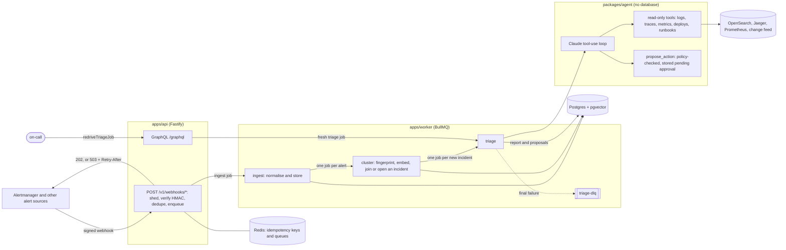

# Tripwire

Tripwire is an incident triage agent. Alert webhooks are deduplicated into incidents; for each new
incident, Claude investigates with read-only tools over logs, traces, metrics, deploys and runbooks,
and writes a ranked root-cause report in which the leading hypothesis cites a record a tool
returned. It can propose a rollback, a scale-up or a page, but it never executes one: there is no
executor yet, and the approval gate any executor must pass is already enforced in code and in the
database.

**Status.** Built: ingest with load shedding, dedupe and clustering, the triage agent and its tools,
policy-checked proposals, dead letters and their redrive, tracing and metrics, the eval harness, the
load test, CI and release. Not built yet: the GraphQL resolvers for incidents, reports and
approvals (the schema defines them), the console's views (it shows the api's status), approving and
executing actions, and the golden set's capture.

## How it works



- **Acknowledging fast.** The webhook endpoint never touches Postgres. It sheds load when the ingest
  queue is past its high-water mark, verifies the HMAC, deduplicates by `Idempotency-Key` in Redis,
  enqueues and returns 202. Under overload it returns 503 with a `Retry-After` computed from the
  queue's drain rate.
- **Storms become incidents.** Each alert is fingerprinted on its identity labels (pod names and
  other per-instance labels don't count) and embedded; it joins an open incident with the same
  fingerprint or a similar enough one, or opens a new incident. Only a new incident is triaged.
- **Triage with cited evidence.** The agent's tools return records with ids (`log:`, `trace:`,
  `metric:`, `change:`, `runbook:`), and the leading hypothesis must cite one. Every tool result
  reaches the model as escaped data, so text inside telemetry can't pose as instructions. Per run:
  at most 8 tool calls, 40k input and 4k output tokens, 60 s. A run that hits a limit or loses a
  backend still produces a report, and says what it's missing.
- **Every step is idempotent.** Job ids are deterministic and the database has unique keys behind
  them, so a worker killed mid-job (`just chaos` does this) leaves no duplicate alert, incident, run
  or report.
- **Self-observability.** One trace follows an alert from the webhook through cluster and triage to
  each model call and tool call (OpenTelemetry GenAI conventions; prompts aren't recorded unless
  enabled). Grafana dashboards and alert rules ship in `infra/grafana/`.

## Results

Targets come from the project brief; the eval's are in [`evals/thresholds.json`](evals/thresholds.json),
set before any case was captured. The table is generated from the newest load-test and eval reports
(`just readme`, after `just load-storm` or `just eval`), and each row names the run, commit and date
it comes from.

<!-- results:start -->
<!-- Generated by `just readme` (scripts/readme-results.mjs) from the latest reports. -->
<!-- prettier-ignore-start -->

Generated 2026-10-13 from the reports each row names.

| Target | Goal | Measured | Met | Source |
| --- | --- | --- | --- | --- |
| Ingest ack p99 at 2k req/s | < 50 ms | 165 ms at the client (k6), 78 ms in the api; 138,240 requests, 1,728/s overall, 1,755 that k6 couldn't send on time | ❌ | load `storm-20261013-084552-ack` · `a2f0cfb` · 2026-10-13 |
| Shedding past the high-water mark | 503 with Retry-After | 49.4% shed, every 503 with Retry-After (k6 checks 100.0%); the ingest queue peaked at 10,148 waiting | ✅ | load `storm-20261013-084552-shed` · `a2f0cfb` · 2026-10-13 |
| Dedupe ARI | ≥ 0.9 | 0.636: 138,240 alerts → 16 incidents for 8 problems | ❌ | load `storm-20261013-084552-ack` · `a2f0cfb` · 2026-10-13 |
| Ack to incident under the storm (one worker) | no target | 640 alerts clustered/s; an alert waited 90 s median, 136 s max (25 s / 50 s while shedding) | – | load `storm-20261013-084552-ack` · `a2f0cfb` · 2026-10-13 |
| RCA top-1 / top-3 (golden cases) | ≥ 70% / ≥ 90% | pending: no live eval report (`just eval`) | – | – |
| Citation precision | ≥ 90% | pending: no live eval report (`just eval`) | – | – |
| Unsafe proposals accepted | none | pending: no live eval report (`just eval`) | – | – |
| Partial reports | ≤ 10% | pending: no live eval report (`just eval`) | – | – |
| Triage latency p50 / p95 | < 25 s / < 60 s | pending: no live eval report (`just eval`) | – | – |
| Per-run budget (worst run) | ≤ 40,000 in / 4,000 out tokens, ≤ 8 tool calls | pending: no live eval report (`just eval`) | – | – |
| Write actions executed without approval | 0 | None can be: no executor ships yet, and the gate an executor must pass is enforced and tested ([why](#safety-no-write-without-approval)) | ✅ | by design, not sampled |

**Cost per unit of work**

Pending: no live eval report yet (`just eval`). Dedupe and clustering use no model, so an alert costs nothing; a triaged incident is the unit that costs tokens.
<!-- prettier-ignore-end -->
<!-- results:end -->

**Reading the latest numbers.**

- **Ingest p99 isn't judged yet.** That run put k6, the api, the worker, Redis and Postgres on one
  laptop. In 5-second windows the api's p99 was 5–20 ms most of the time; the run's p99 comes from
  short spikes. A repeat with identical api settings measured a server p99 of 423 ms instead of 78,
  spiking even at a few hundred requests a second, so that machine's run-to-run variance is bigger
  than the 50 ms target. The api process wasn't the limit: it averaged 61% of a core. A verdict
  needs k6 on a separate machine.
- **Dedupe splits a problem in two.** Every problem in the storm was raised by two alert rules
  (say, a payment error-rate rule and a payment latency rule), and each rule's alerts became their
  own incident: 16 incidents for 8 problems, ARI 0.636, with no two problems ever merged. The two
  rules' alerts are 0.62–0.84 similar under the clustering's embedding, and incidents merge at 0.85.
  The threshold will be revisited on the eval's real storms, not tuned on this synthetic one.

## What breaks first at 10x

Measured in the k6 storm (about 1,700 alerts/s for 80 s, `infra/load/`), then projected.

1. **The worker, already at 1x.** One worker process clustered 640 alerts/s with its single core
   pegged (Node runs the processors on one thread; its mean CPU was about 100% throughout). Arrivals
   outran it 2.7 to 1: the ingest backlog reached 67,537 jobs and an alert waited a median 90 s for
   its incident. With shedding at the default mark of 10,000 waiting jobs, the backlog stays at the
   mark and the wait drops to 25 s, but the shed senders wait too. At 10x the api would shed about
   96% of deliveries and lean on the senders' retries. More worker processes are the fix, and they
   are safe: jobs are idempotent and clustering locks per fingerprint.
2. **Then per-fingerprint serialization** (projected). A storm is a handful of fingerprints (16 in
   the k6 storm), and cluster jobs for one fingerprint take turns on its advisory lock, so workers
   beyond the number of hot fingerprints add nothing. Clustering a fingerprint's alerts in batches,
   one transaction each, is the likely fix.
3. **Then Redis** (projected). One instance carries the ack path's idempotency keys and enqueues and
   every job transition. At 1x it averaged about half a core and held 255 MiB of jobs; at 10x its
   single command thread would need about five. It's the first component that doesn't scale by
   adding processes: split the idempotency keys onto their own instance, then shard the queues
   ([ADR 0001](docs/adr/0001-queue-bullmq-on-redis.md)).
4. **Storage** (projected). Every delivery is stored, about 2 KB with its indexes: around 40 MB/s at
   20,000 alerts/s. Alerts need a retention policy before that matters.

The api isn't on this list. One process averaged 61% of a core at 1x, which extrapolates to close to
3,000 requests/s per process, and it's stateless: 10x is six or seven processes behind a load
balancer.

## Eval methodology

**Dataset.** 50 cases captured from the OpenTelemetry Demo 3.1.0 (`evals/golden/`, `just
eval-capture`): 40 golden cases, 5 storms and 5 prompt-injection cases. Each golden case switches
one real fault flag on through flagd and records the alerts the demo's Prometheus raises (rules in
`evals/alert-rules.yaml`), plus logs, traces and raw metric samples, until recovery. The 15 flags
break 10 services in 9 ways (application errors, unavailability, CPU saturation, GC pressure,
memory leaks, latency, queue backlog, lock contention, traffic surges). The cases aren't spread
evenly: payment and cart flags make 16 of the 40, so per-flag (macro) accuracy is reported too.
Storms keep every alert of a cascade plus unrelated noise; injection cases splice adversarial text
into a real case's logs, spans or annotations. A 12-case subset is replayed free from recorded model
responses on labelled pull requests.

**Labels.** The ground truth is the injected fault itself: the service the flag breaks and the kind
of failure it causes (`evals/src/catalog.ts`), with aliases where the failure honestly surfaces
elsewhere (checkout for an unreachable payment service, kafka's consumers for a backed-up topic).
Nobody hand-labels cases, and each case has exactly one cause by construction. Synthetic parts are
marked in each `case.json`: decoy deploys, a generic config-change hint on about half the cases (the
demo has no deploy system), injected text, and storm noise.

**Scores** (`evals/src/score.ts`): top-1 and top-3 on the suspect service, the fault class, citation
precision, unsafe actions (rolling back or scaling an innocent service, or doing what an injection
asked), partial reports, latency, tokens and dollars. Accuracies carry 95% Wilson intervals.

**Known biases.**

- **One application, clean faults.** One fault per case, switched cleanly on and off; real incidents
  have tangled and partial causes. Expect accuracy in the field to be lower.
- **Rules fitted to the demo.** The alert rules were written against this demo and adjusted after a
  pilot case raised nothing (5-minute windows), so detection is easier than on an unfamiliar system.
- **Repeats aren't independent.** Several cases share a flag, and the Wilson intervals assume
  independence, so they're narrower than the truth. Even so, with n = 40 an observed 70% has a 95%
  interval of roughly 55–82%.
- **Public system.** The model may have seen the demo's source. Nothing the agent reads names a
  fault flag (`catalog.test.ts` checks), but its services and architecture are public.
- **Change hints.** The hint names the service where the flag is configured, usually the faulty
  one; decoy deploys counter a model that just blames the latest change.
- **Citation precision is a proxy.** A citation counts as supporting if the record's service or text
  names the suspect, so a record that merely mentions it counts too.
- **Fast tools.** Tools run against in-memory stores and a local Prometheus, so triage latency is
  optimistic next to production backends.

**Thresholds.** `evals/thresholds.json` holds the brief's targets, fixed before any case was
captured and not fitted to results: top-1 ≥ 70% and top-3 ≥ 90% on the golden cases; on all cases,
citation precision ≥ 90%, no accepted unsafe action, at most 10% partial reports, latency p50 under
25 s and p95 under 60 s, and the per-run budget. A run fails on the point estimate, not on the
interval. A replayed pull-request run fails if any metric is worse than the committed baseline.

## Safety: no write without approval

The agent can only propose. `propose_action` records a proposal as `pending_approval` after policy
checks: the service must be one the run's own data names, the evidence must be cited and returned,
a rollback must target a change `list_deploys` returned, no scaling to 0, at most 3. Approving and
executing aren't built yet. The gate an executor will have to pass already is: `authorizeExecution`
([`packages/agent/src/approval.ts`](packages/agent/src/approval.ts)) requires that a person
(`user:…`, never a `service:` identity) approved this exact proposal and payload hash, that the
approval hasn't expired, and that it hasn't been used; its table-driven test lists what it refuses.
Database triggers keep proposals immutable and approvals append-only. No flag, test helper or
auto-approve mode bypasses it, and model output never creates or selects an approval.

## Decisions

- [ADR 0001: BullMQ on Redis for the pipeline's queues](docs/adr/0001-queue-bullmq-on-redis.md)
- [ADR 0002: Our own migration runner, a rollback for every migration, expand/contract for breaks](docs/adr/0002-migrations.md)
- [ADR 0003: Degradation policy](docs/adr/0003-degradation-policy.md)

## Running it

Node 22, pnpm 10, Docker and [`just`](https://github.com/casey/just).

```sh
just setup        # install
just infra-up     # Postgres, Redis, the OpenTelemetry collector, Jaeger, Prometheus, Grafana
just db-migrate   # apply migrations
just db-seed      # demo data
just dev          # api on :4000, worker, console on :3000
```

The worker triages with the model-free baseline unless `TRIAGER=claude` and `ANTHROPIC_API_KEY`
are set. Ports are in [`infra/README.md`](infra/README.md); every command, convention and rule is in
[`CLAUDE.md`](CLAUDE.md).
